# Promon SHIELD research

Some notes from reverse engineering Promon SHIELD 8.2.4 on an ARM64 Android
application.

The repository focuses on:

- SHIELD's native unpacking and control-flow flattening
- Its self-tracer and live-vs-file integrity checks
- The address, mapping, relocation, and code-byte evidence its workers combine
- Why common concealment ideas failed
- The finite startup and mutation windows measured in the observed build

## Quick checks

```sh
ruff check .
python3 -m unittest discover -s tests -v
python3 -m compileall -q scripts binaryninja
```

See [`scripts/README.md`](scripts/README.md) for the offline recovery pipeline.

## Start here

1. [Observed architecture](docs/architecture.md)
2. [Instrumentation and concealment findings](docs/instrumentation-findings.md)
3. [Protected-region recovery](docs/unpacking.md)
4. [Live-vs-file integrity scanner](docs/integrity-scanner.md)
5. [Self-tracer](docs/self-tracer.md)
6. [Binary Ninja workflow](docs/binary-ninja-workflow.md)
7. [Experimental method and failure controls](docs/methodology.md)
8. [Detector families and isolated signals](docs/detector-signals.md)
9. [Root and environment checks](docs/environment-checks.md)
10. [Protected services and poison transition](docs/protected-services.md)

## Diagrams

### SHIELD observation and enforcement



### Startup and verdict sequence



### Integrity evidence and correlation



### Live-vs-file scanner decision flow



### Concurrent verdict race



### Self-tracer state machine



### Protected-code recovery



### Main-region unpacking internals



## Disclaimer

This project was developed with the assistance of AI tools. AI was used for tasks such as code generation, refactoring, debugging, documentation, reverse engineering and general development support.
